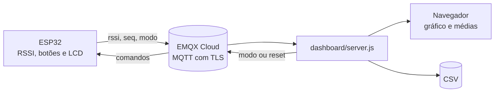

# Atividade Ponderada de Computação 3: medição do sinal Wi-Fi com ESP32 e MQTT

O ESP32 lê o RSSI do Wi-Fi (em dBm) a cada 2 s, mostra cada leitura no Monitor Serial e no LCD e publica o mesmo valor por MQTT. Um dashboard atualiza o gráfico a cada amostra e calcula média, mínimo e máximo em cada condição de teste.

As escolhas que diferem do barema estão justificadas no [ADR](#adr-escolhas-diferentes-do-barema).

## Como funciona



| Tópico | Sentido | Mensagem |
|---|---|---|
| `rssi-wifi/esp32-39` | ESP32 para o dashboard | `{"rssi":-55,"seq":12,"modo":3}` |
| `rssi-wifi/esp32-39/cmd` | dashboard para o ESP32 | `{"modo":3}` ou `{"reset":1}` |

Se a conexão cair, o Serial mostra `[wifi] SEM CONEXAO` e o gráfico marca a interrupção e a retomada. Nenhum valor é criado para o período sem dados.

## Montagem

| Componente | Ligação |
|---|---|
| ESP32 com antena externa (a placa do protótipo do grupo) | USB do notebook |
| LCD 16x2 I2C (endereço 0x27) | SDA no GPIO21, SCL no GPIO22, 5 V e GND |
| Botão AVANÇAR | GPIO25 e GND |
| Botão VOLTAR | GPIO26 (ou GPIO32) e GND |

Os botões usam o pull-up interno. AVANÇAR anda um passo na sequência (Trocando, condição 1, Trocando, condição 2...) e VOLTAR desfaz um. As amostras em "Trocando" não entram nas médias.

## Como rodar

**ESP32** (testado com o core `esp32` 2.0.17, PubSubClient 2.8 e LiquidCrystal I2C 1.1.2)

1. Copie `rssi-wifi/secrets.example.h` para `rssi-wifi/secrets.h` e preencha o Wi-Fi e o broker. O `secrets.h` é ignorado pelo Git.
2. Abra `rssi-wifi/rssi-wifi.ino` na Arduino IDE, escolha **ESP32 Dev Module** e grave.
3. Abra o Monitor Serial a 115200 baud.

**Dashboard** (Node.js)

```bash
cd dashboard
npm install
npm start
```

Abra http://localhost:3939. Para ver também no celular, use `npm run rede`: o dashboard abre no Wi-Fi apenas se o notebook estiver na mesma rede do ESP32.

## Condições de teste

| Comparação | Condições |
|---|---|
| Recipiente metalizado | fora (antes), dentro, fora (depois) |
| Mãos | antena descoberta, coberta com as mãos |
| Posição da antena | vertical, horizontal |
| Distância do roteador | perto, longe |

São as oito condições do enunciado, mais a volta ao estado inicial depois da blindagem. Cada cartão guarda as cinco primeiras amostras. As seguintes aparecem em cinza no gráfico e não entram na média. Uma queda de conexão é registrada como resultado.

## ADR: escolhas diferentes do barema

**Data:** 25/11/2026
**Autor:** Luiz
**Grupo:** Grupo 1

### Contexto

O barema pede a publicação no broker local da sala, com o `inteli_broker.h`, e a visualização no Node-RED. O enunciado pede o Wi-Fi da sala. O protótipo do grupo já usava EMQX Cloud, LCD e botões, e aproveitei essa base.

Consultei o professor, que dispensou o broker local e o Node-RED nesta entrega e confirmou o ID 39. A dispensa não trata do Wi-Fi (decisão 3).

### Decisão 1: EMQX Cloud no lugar do broker local

- **Alternativa considerada:** broker da sala com o `inteli_broker.h`.
- **Razão técnica:** é o mesmo broker do protótipo do grupo, com TLS e login, e funciona fora da sala. O `inteli_broker.h` reinicia a placa se ficar 20 s sem Wi-Fi. Na blindagem, em que a queda é um resultado esperado, o reinício faria a placa perder o modo em teste. No meu sketch, a placa reconecta sem reiniciar, e os botões e o LCD continuam respondendo.
- **Consequência:** depende de internet, e a telemetria não passa pelo broker da sala.

### Decisão 2: dashboard próprio no lugar do Node-RED

- **Alternativa considerada:** um gráfico no Node-RED ligado ao tópico de telemetria.
- **Razão técnica:** o teste pede mais que um gráfico. O dashboard liga cada amostra à condição em que a placa a mediu, conta as cinco amostras, calcula as médias, marca interrupção e retomada, troca o modo da placa e guarda um CSV.
- **Consequência:** há mais código para manter, e ele roda com Node.js no notebook.

### Decisão 3: hotspot do celular no lugar do Wi-Fi da sala

- **Alternativa considerada:** a rede da sala.
- **Razão técnica:** é a rede que o protótipo já usava, com a internet de que o EMQX Cloud precisa. Com um único ponto de acesso, o ESP32 não troca de roteador no meio de um teste, o que mudaria o RSSI por outro motivo. O Serial mostra o BSSID e o canal para conferir.
- **Consequência:** o celular faz o papel do roteador. Ele fica parado em todas as comparações, menos na de distância, e os valores não descrevem a cobertura do Wi-Fi da sala.

### Decisão 4: ID 39, fora da faixa do Grupo 1

- **Razão:** é o número anotado na placa que recebi. Os ESP32 foram distribuídos trocados, e o professor confirmou o ID. Ele aparece no tópico e no nome do cliente MQTT.

### Decisão 5: uma amostra a cada 2 s no lugar de 5 s

- **Alternativa considerada:** os 5 s do `inteli_broker.h`.
- **Razão técnica:** cinco amostras levam 10 s em vez de 25 s. As nove etapas cabem no vídeo de 3 a 5 minutos com tempo para explicar cada uma.
- **Consequência:** mais mensagens por minuto, sem efeito no volume deste teste.

### Decisão 6: modos por botão e LCD, além do que foi pedido

- **Razão técnica:** marcar a condição na própria placa evita atribuir uma amostra à condição errada. Durante os testes, as amostras que ainda estavam a caminho eram contadas no modo recém-clicado na página. Agora a placa envia o modo junto com o RSSI.

### Limites

- O RSSI sozinho não garante conexão estável e não identifica a causa de uma interferência.
- A sala reflete o sinal, então a diferença entre duas condições pode variar de uma execução para outra.

## Entregas

- [x] Sketch do ESP32 em `rssi-wifi/`
- [x] Dashboard em `dashboard/`
- [x] ADR
- [ ] Vídeo de 3 a 5 minutos, com acesso para qualquer pessoa com o link
